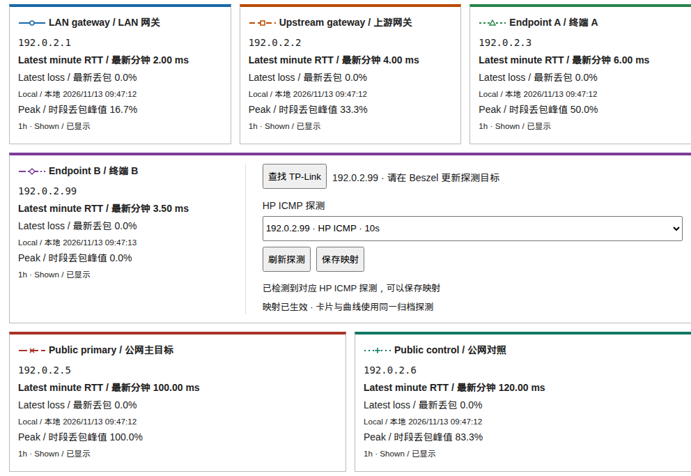
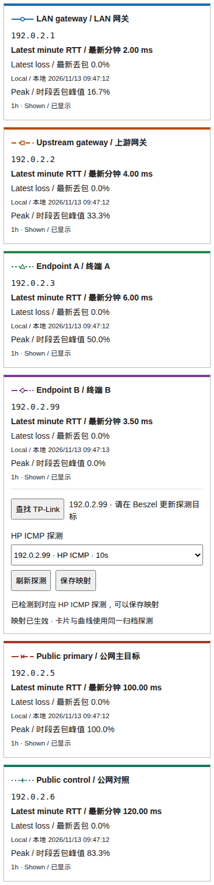

# Network quality layout and PR30 acceptance repair

Based on merged PR30 (`b1de1f5`). Production remains at `1087536` plus its preserved local changes and v3 compatibility collector. No production deployment is claimed by this PR.

Desktop uses three cards (LAN gateway, Upstream gateway, Endpoint A), a full-width Endpoint B with metrics left and all discovery controls right, then two equal Public cards. At 600px and below all six cards stack in that order. Existing CPU patches, network archive, private mappings and rollback artifacts are retained.

## Incident review (America/Toronto, 2026-11-13 08:49–09:15)

The latest `ssh-run-20261113T134834Z-6lYMtAwy` saved the .71 HP ICMP mapping at **08:49:44.240195**. The time conversion was correct: `saved_at` seconds × 1000 is compared with sample `created_ms`, not archive insertion time.

| Sample time | Successful / total probes | Archive insertion | Interpretation |
| --- | --- | --- | --- |
| 08:49:35.685 | 6 / 6 | 08:50:03.166 | Older than save; cannot prove a new sample |
| 08:50:35.655 | 6 / 6 | 08:55:03.517 | New successful sample |
| 08:51:35.661 | 3 / 6 | 08:55:03.517 | New sample with partial loss |
| 08:52:35.653–08:54:35.657 | 0 / 6 each minute | 08:55:03.517 | Batch ends in complete loss |
| 08:55:35.660–09:04:35.672 | 0 / 6 each minute | 09:00 / 09:05 / 09:10 runs | New loss observations continue |

The five natural archive runs completed successfully, with `network_failed=0` and inserted counts **40, 40, 40, 40, 38**. SQLite retains all 16 .71 minute records in the requested window. The failure screenshot at 09:14 shows Portal displaying .71, sample time 09:04:35, 100% loss, RTT unavailable, and an active mapping. A read-only replay of the PR30 history query against the retained archive returns that same latest sample and the earlier successful samples.

**Upstream evidence limitation:** the old .71 monitor is now absent from live Beszel, and querying its old ID returns no minute records. Current Beszel instead lists the .76 HP ICMP monitor. This investigation made no upstream changes. Historical upstream values are evidenced by the archive's retained Beszel records, saved discovery/mapping receipts, and the original browser screenshot; a new live Beszel fetch cannot independently reproduce the removed monitor's data. The original run did not retain each API response; historical query replay is identified separately from the actual screenshot.

The original acceptance required the **latest** sample to have a successful probe. At the first eligible archive batch (08:55), earlier new successes were present but the latest sample reported complete loss. The repaired check requires both a latest new observation shared by card/curve and at least one successful probe in a post-save sample. It records latest reachability separately and never converts a loss sample to success or counts an older sample merely because it was inserted later. Private per-poll API observations are now retained.

Rollback verification independently failed at `int('3d 11h 13min 53.422345s')`: systemctl formats monotonic times as durations on this host. All deployment/rollback monotonic comparisons now accept raw microseconds and exact human duration values using Decimal arithmetic; malformed values fail with context. Exceptions retain a traceback in the private execution log.

## Validation

- Python suite: 161 tests, including the actual systemd duration regression.
- JavaScript acceptance regression: pre-save success rejected; fresh complete loss alone rejected; new success followed by a newer loss sample accepted; wrong address rejected.
- Chromium interaction and layout checks: 1440, 768, 390 and 320px; discovery none/multiple/waiting/ready states, dropdown, refresh/save, first archive sample, matching target/curve, requested row geometry and no horizontal overflow.
- Existing network graph browser regression: desktop/mobile, seven ranges, weighted statistics, hover/pin, touch/keyboard, loss records.
- Synthetic screenshots below contain documentation addresses only. They demonstrate UI behavior, not live production acceptance.

## Deployment package

`tools/deployment/prepare.py OLD_PACKAGE NEW_PACKAGE EXACT_MERGE_SHA` creates a separate private package, verifies the original checksums, retains the existing compatibility collector and local patches, merges those patches onto the exact new target, and pins `run.sh` to that SHA. It leaves the old package and production unchanged. Package preparation fails on merge conflicts; its forward patch is checked and tested again in an isolated stage before production mutation.

The SSH entry verifies remote main equals the pinned merge commit, checks effective HP identity, private files and existing state, preserves a before-state copy, deploys with the collector writer lock, restarts only Portal, clicks discovery/save on the real page, waits for the existing archive timer, then verifies real post-save samples, CPU old/new history, preserved archive rows, timer and Web health. No mocked API is used for live acceptance. Failure restores the original Web/local patches, retains the v3 collector and private evidence, and verifies a subsequent natural archive run. No SQLite restore, truncation or deletion is performed.
